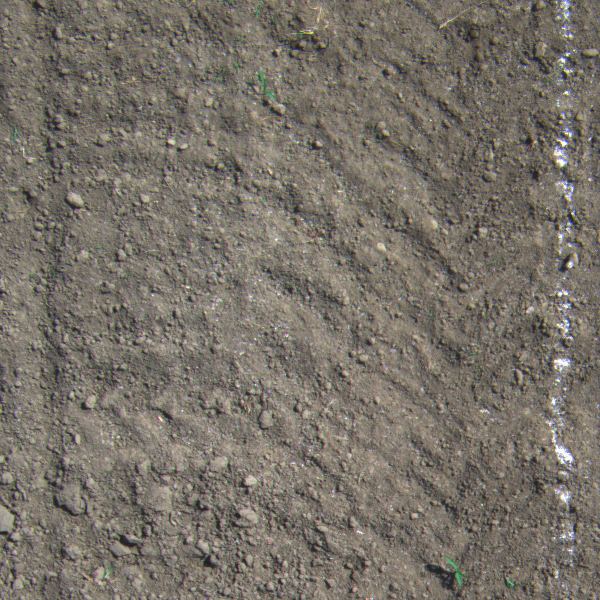
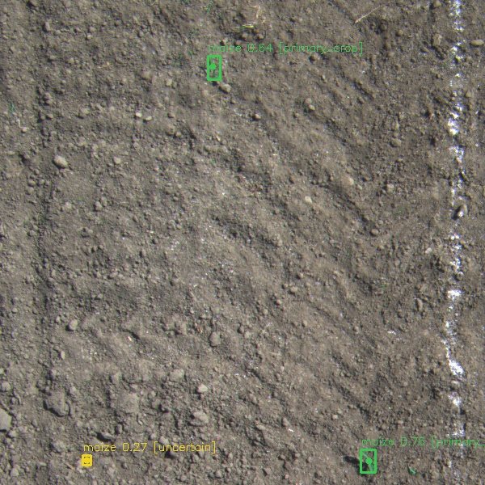
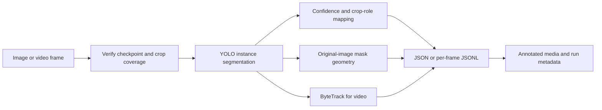

# CropGuard

### Crop and weed localization for images and video

CropGuard is a Python machine-learning pipeline that locates individual plants and returns their original-image pixel coordinates. It combines YOLO instance segmentation, confidence-aware crop/weed roles, and ByteTrack video tracking with a reproducible training and evaluation workflow.

**Project status:** a tested research baseline. The included checkpoint is trained for **maize and weeds only**. Tomato, chilli, additional vegetation, and unseen-field generalization are development goals, not established capabilities. Weed recall is currently low; see the measured results below.

[Quick start](#quick-start) | [Results](#measured-results) | [Training](#train-on-public-data) | [Coordinates](#coordinate-format) | [Model card](MODEL_CARD.md) | [Dataset sources](DATASETS.md)

## What it does

- Detect and segment plants in local images and video files.
- Return bounding boxes, complete predicted masks, centroids, an additional point inside each mask, confidence scores, and class/role labels.
- Track detections across video frames and write per-frame JSONL without loading an entire video into memory.
- Save annotated images or video alongside machine-readable predictions.
- Train, resume, and evaluate segmentation models with strict annotation checks and exact duplicate checks across dataset splits.
- Verify that checkpoint coverage metadata matches the weight file before inference, and reject unsupported primary-crop profiles.

The package defines a vocabulary for `weed`, `maize`, `tomato`, `chilli`, `other_crop`, and `unknown_plant`. Only maize and weed have training coverage in the included checkpoint. A class name in a configuration file does not teach a model to recognize that class.

## Measured results

The baseline was trained for 60 epochs on the public [WeedsGalore dataset](https://github.com/GFZ/weedsgalore), using its official 104 / 26 / 26 image train/validation/test split.

| Test metric | Result |
| --- | ---: |
| Overall box mAP@50 | 64.9% |
| Overall mask mAP@50 | 52.2% |
| Maize box mAP@50 | 86.7% |
| Weed box mAP@50 | 43.1% |
| Automated tests | 16 passing |

At confidence **0.60**, the original-mask localization audit measured:

| Class | Precision | Recall | Mean centroid error, matched plants only |
| --- | ---: | ---: | ---: |
| Weed | 90.2% | 11.8% | 1.64 pixels |
| Maize | 90.9% | 58.6% | 2.40 pixels |

These centroid errors exclude missed plants. They do not establish exact stem positions or physical targeting accuracy. mAP is an average-precision metric, not an overall accuracy percentage. Results describe this dataset split; new-field and moving-video performance remain unvalidated.

Read the [full model card](MODEL_CARD.md), [evaluation JSON](reports/evaluation.json), [coordinate audit](reports/localization-test.json), and [verification record](reports/verification.json).

## Quick start

### 1. Clone and install

Python **3.11-3.13** is supported; the baseline was tested with Python 3.12.

```bash
git clone https://github.com/Parth-73/CropGuard.git
cd CropGuard
python -m venv .venv
```

Activate the environment:

```powershell
# Windows PowerShell
.venv\Scripts\Activate.ps1
```

```bash
# Linux / macOS
source .venv/bin/activate
```

Install the package and ML runtime:

```bash
python -m pip install -e ".[ml,dev]"
```

CPU inference works without an NVIDIA GPU. For GPU inference/training, install an appropriate CUDA-enabled PyTorch build using the [official PyTorch installer](https://pytorch.org/get-started/locally/) before installing this package. The GPU environment used here was PyTorch 2.11.0+cu128 / torchvision 0.26.0+cu128 on an RTX 4050. Tested environment snapshots are in `requirements-tested.txt` and `requirements-gpu-tested.txt`; they record this machine's versions rather than a universal installation recipe.

### 2. Run the bundled example

The small trained checkpoint and its required metadata are included in this repository. You do not need to download training data to try inference.

```bash
cropguard predict --weights models/maize_baseline/best.pt --source examples/input-image.png --primary-crop maize --imgsz 512 --output outputs/my-first-image
```

An image run writes:

```text
outputs/my-first-image/
  predictions.json
  annotated.jpg
  run.json
```

Use a new output directory for each run. Existing output directories are rejected to protect earlier results. Keep `best.pt` and `best.cropguard.json` together; the metadata includes the checkpoint's SHA-256 and supported crop profiles.

### 3. Process your image or video

```bash
# Image
cropguard predict --weights models/maize_baseline/best.pt --source path/to/image.jpg --primary-crop maize --imgsz 512 --output outputs/my-image

# Video
cropguard predict --weights models/maize_baseline/best.pt --source path/to/video.mp4 --primary-crop maize --imgsz 512 --output outputs/my-video
```

Video output contains `predictions.jsonl`, `annotated.mp4`, `video.json`, and `run.json`. Each JSONL record identifies the frame index, estimated timestamp, image dimensions, and detections.

Useful options:

| Option | Purpose |
| --- | --- |
| `--device 0` | Use a compatible NVIDIA GPU; default is CPU |
| `--confidence 0.25` | Minimum retained detection confidence |
| `--review-threshold 0.60` | Mark retained lower-confidence detections as uncertain |
| `--no-annotated` | Write predictions without annotated media |
| `--no-masks` | Omit the potentially large lossless RLE mask payload |
| `--max-detections 1000` | Raise the default 300-detection cap for dense scenes |

For the provided checkpoint, use `--imgsz 512`: this resolution was selected using validation mask mAP50-95. Larger inference sizes did not improve that selection metric. Confidence thresholds are initial settings, not calibrated probabilities.

## Example output

<table>
<tr><th>Input</th><th>Baseline prediction</th></tr>
<tr><td></td><td></td></tr>
</table>

Images are derived from WeedsGalore, Celikkan et al., WACV 2025, under CC BY 4.0. See [example attribution and selection notes](examples/README.md).

Inspect [image predictions](examples/image-predictions.json), a [dense-scene prediction](examples/dense-annotated.jpg), or the [annotated video smoke test](examples/annotated-video.mp4). The five-frame video repeats one test image to exercise the tracking/encoding pipeline; it is not a real moving-field video benchmark.

## Coordinate format

Each detection contains the following fields (values below are illustrative):

```json
{
  "instance_id": 0,
  "track_id": null,
  "class_id": 1,
  "label": "maize",
  "confidence": 0.91,
  "role": "primary_crop",
  "bbox_xyxy": [120.4, 88.7, 205.2, 231.6],
  "mask_bbox_xyxy": [121, 89, 205, 232],
  "centroid_xy": [163.8, 159.1],
  "mask_point_xy": [164.5, 159.5],
  "area_px": 6890
}
```

- Coordinates use the **original decoded image dimensions**, with origin at top-left, x increasing right, and y increasing down.
- `bbox_xyxy` is `[x1, y1, x2, y2]`; upper bounds are exclusive. `mask_bbox_xyxy` bounds the predicted foreground pixels.
- Pixel centers use `(column + 0.5, row + 0.5)`. `centroid_xy` averages foreground pixel centers.
- A centroid can fall outside a concave mask. `mask_point_xy` provides the nearest foreground pixel center to it; this does not identify the plant's stem.
- `mask_rle` losslessly encodes the **predicted** binary mask, including holes and disconnected regions. Counts are row-major (`order: C`), alternate background/foreground, and start with a background run, possibly zero. This is different from COCO's column-major RLE.

Roles are `primary_crop`, `weed`, `other_crop`, and `uncertain`. Low-confidence retained detections and trained `unknown_plant` predictions are uncertain. A recognized non-primary crop remains another crop; selecting a primary crop does not make all other vegetation a weed. The current maize-only model cannot reliably recognize tomato or chilli as other crops.

Track IDs are scoped to one video and can change after occlusion. Timestamps use frame index / FPS and are estimates for variable-frame-rate footage. Annotated video has no audio. Pixel coordinates need camera calibration and scene geometry to become physical ground coordinates.

## How it works



## Train on public data

The repository includes a converter for the **original** WeedsGalore archive. It assembles RGB from the R/G/B bands, combines semantic and instance annotations, verifies the archive checksum, preserves official splits, and records provenance. Full datasets and local training runs are not included in Git.

On Windows PowerShell, after installing the package:

```powershell
.\scripts\prepare_public_data.ps1
```

Alternatively, download the [original archive](https://doidata.gfz.de/weedsgalore_e_celikkan_2024/weedsgalore-dataset.zip), then run:

```bash
python scripts/prepare_weedsgalore.py --archive path/to/weedsgalore-dataset.zip
```

The converter retrieves the official split lists from the authors' GitHub repository. Dataset output must be a new directory. Then validate and train:

```bash
cropguard check-data --data configs/weedsgalore.yaml --require-test

cropguard train --data configs/weedsgalore.yaml --base yolo11n-seg.pt --output runs/my-maize-model --epochs 60 --imgsz 512 --batch 8 --device cpu --allow-partial
```

The first training run downloads the pretrained base weights if they are not available locally. Set `--device 0` for CUDA. `--allow-partial` explicitly permits training the maize/weed subset; without it, all six classes must have training and validation instances. Best weights and coverage metadata are written under `runs/my-maize-model/fit/weights/`.

Resume an interrupted run:

```bash
cropguard resume --weights runs/my-maize-model/fit/weights/last.pt --device 0
```

Training data checks reject invalid polygons, missing labels, orphan annotations, unreadable images, and exact duplicate image leakage across splits. They do not detect adjacent frames or re-encoded near duplicates. Split by field, season, acquisition session, and video before extracting images.

## Evaluate a checkpoint

Use validation data to choose settings, then reserve test data for the final report:

```bash
cropguard evaluate --data configs/weedsgalore.yaml --weights models/maize_baseline/best.pt --output outputs/my-test-evaluation --split test --imgsz 512

cropguard localization --data configs/weedsgalore.yaml --weights models/maize_baseline/best.pt --output outputs/my-localization-test.json --split test --confidence 0.60 --imgsz 512
```

The localization command requires the original WeedsGalore dense masks prepared by the converter. It reports per-class instance precision/recall, semantic IoU, matched-mask centroid errors, and crop/weed overlap diagnostics. Reports from the delivered baseline are already available in [reports/](reports/).

## Extend to tomato, chilli, and other vegetation

1. Obtain representative **whole-plant instance outlines and labels**, including crops, weeds, hard negatives, growth stages, and difficult lighting/backgrounds. Fruit detection and leaf-disease classification datasets cannot directly supervise whole-plant localization.
2. Use the IDs in `configs/plants.yaml`: `0 weed`, `1 maize`, `2 tomato`, `3 chilli`, `4 other_crop`, `5 unknown_plant`.
3. Place images under `data/plants/images/{train,val,test}` and YOLO polygon labels under `data/plants/labels/{train,val,test}`. Each line is `class_id x1 y1 x2 y2 ...`, with normalized coordinates and at least three vertices per plant.
4. Validate, train, and evaluate on independent fields/cameras/seasons. Empty label files are permitted only for reviewed background images; missing labels fail validation.
5. For an additional primary species, extend the taxonomy, crop normalization, class IDs, and checkpoint coverage calculation together, then retrain.

A closed-set network does not automatically identify unseen vegetation. The checked public dataset coverage and outstanding annotation gaps are documented in [DATASETS.md](DATASETS.md).

## Tests

```bash
python -m pytest -q
```

The delivered baseline passed 16 tests covering coordinate conventions, lossless RLE, in-mask points, crop-role rules, checkpoint integrity, annotation validation, split leakage, actual Ultralytics result objects, and video decoding/encoding. Real CPU/GPU checkpoint inference and the video smoke test were also verified separately. Install the ML extra to run the integration tests; otherwise those tests are skipped.

## Repository layout

```text
CropGuard/
  src/cropguard/             Training, inference, tracking, geometry, and CLI
  configs/                  Dataset taxonomy and paths
  scripts/                  Dataset preparation and run finalization
  tests/                    Unit and integration tests
  models/maize_baseline/     Trained weights and required coverage metadata
  examples/                 Small attributed inputs and generated predictions
  reports/                  Evaluation, localization, provenance, and training history
  docs/concept/             Project concept document and presentation
  docs/licenses/            Relevant third-party license texts
  MODEL_CARD.md             Detailed measurements and limitations
  DATASETS.md               Public dataset review and annotation gaps
```

## Roadmap

- Improve small-weed recall and mask quality using stronger data coverage and validation-driven training.
- Add verified tomato/chilli instance annotations and more crop/weed species.
- Evaluate genuinely independent fields, ground-level cameras, seasons, and real moving video.
- Measure latency across the complete video pipeline and validate camera-to-ground coordinate conversion separately.

## Attribution and licensing

WeedsGalore images/annotations and the bundled examples are attributed to Celikkan et al., WACV 2025, under [CC BY 4.0](docs/licenses/WEEDSGALORE-CC-BY-4.0.txt). The archive SHA-256, source URLs, citation, and conversion notes are recorded in [dataset provenance](reports/dataset-provenance.json).

The implementation depends on Ultralytics, which provides [AGPL-3.0](docs/licenses/ULTRALYTICS-AGPL-3.0.txt) and enterprise licensing options. No separate permissive license is asserted for the original CropGuard code or trained checkpoint here. See [third-party notices](docs/THIRD_PARTY_NOTICES.md).
